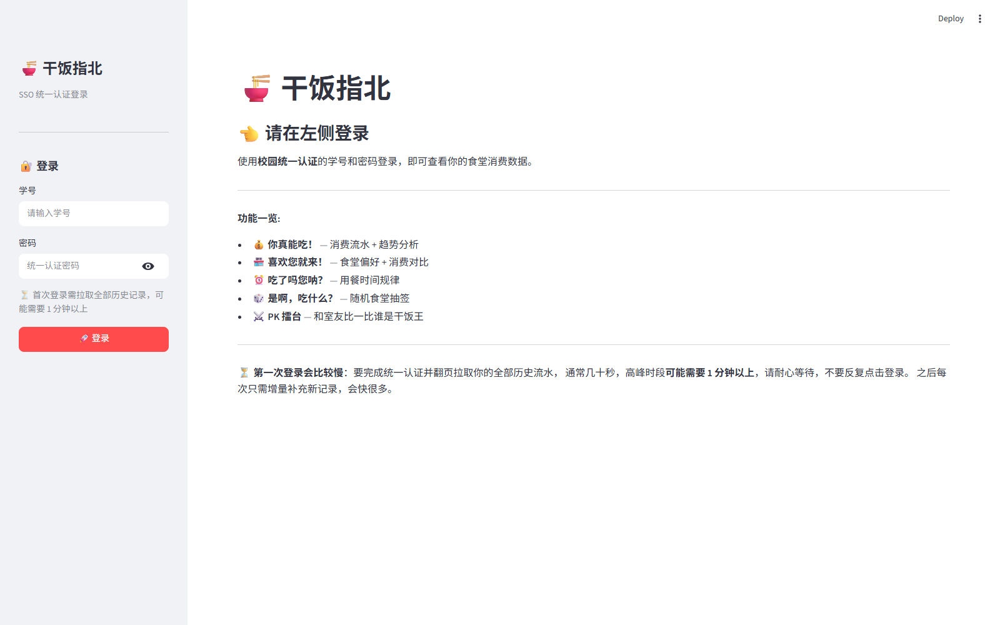
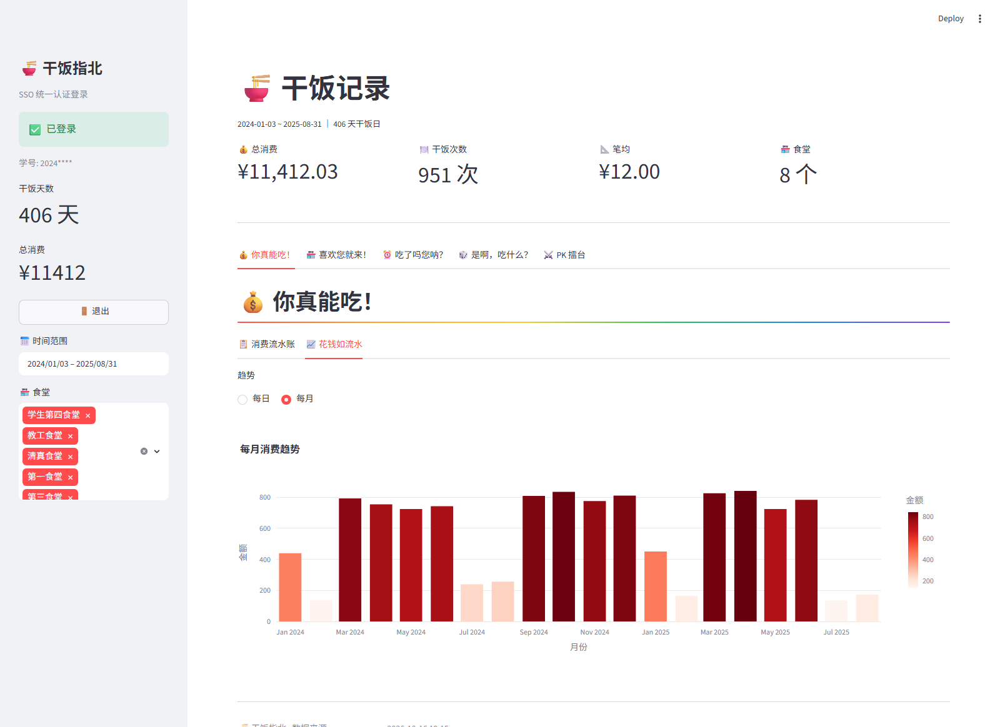
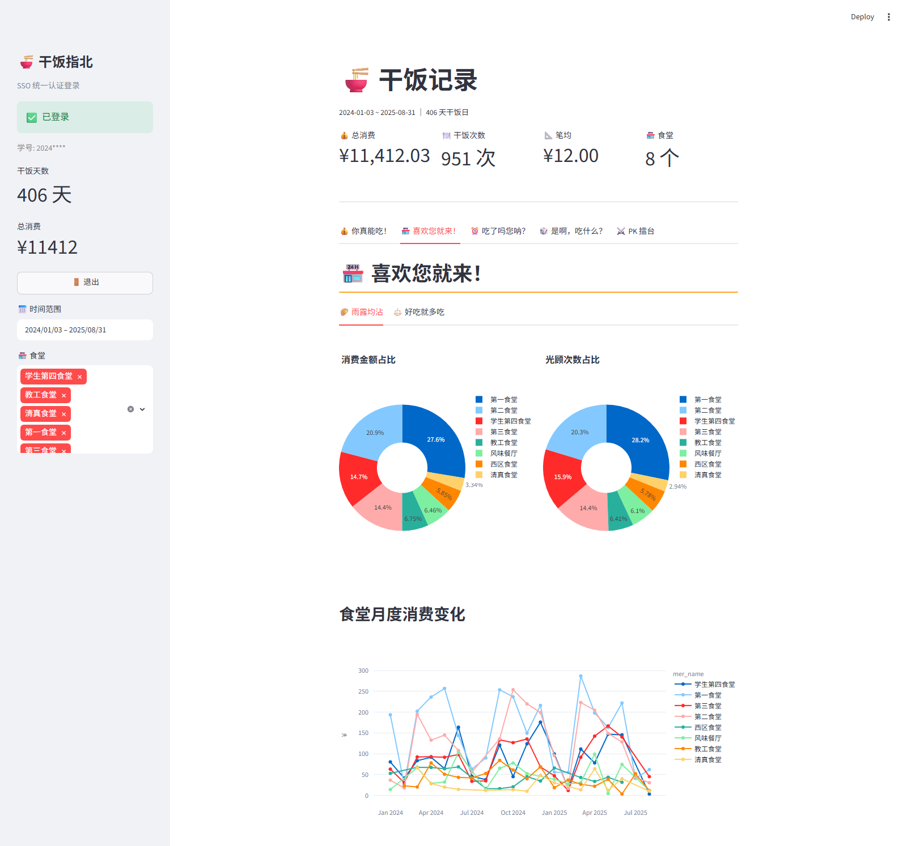
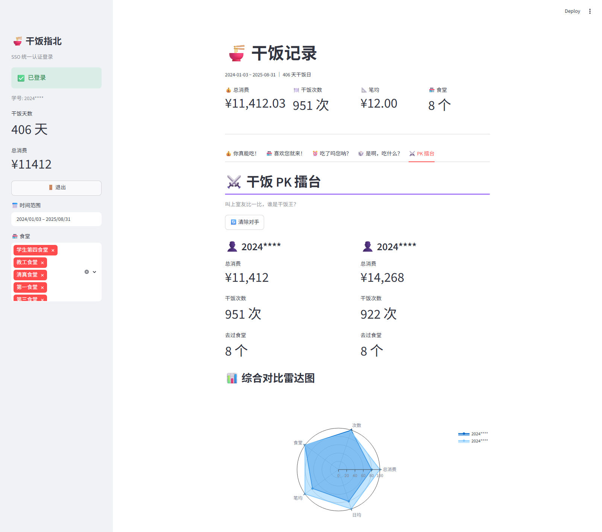

# 🍜 Dining Trace · 干饭指北

> 用你的校园卡消费记录，回答三个灵魂问题：**我到底花了多少钱？我为什么总去那家食堂？今天中午吃什么？**


**Dining Trace（干饭指北）** 是一个校园卡消费分析工具：用学校统一认证（SSO）登录后，自动拉取你在食堂的消费流水，存进本地 SQLite，然后用一个交互式可视化面板把「吃什么、花多少、几点吃、和室友谁更能吃」全部画出来。

项目最初是《人工智能导论》课程的「AI+X」大作业（AI 辅助编程实践），代码在需求、调试与优化中反复打磨而成，现在整理开源。

> ⚠️ **本项目与任何学校官方无关**，仅用于个人学习与娱乐。它读取的是**你自己**的消费数据，只存在**你自己**的电脑上。

---

## ⚡ 给第一次使用的你（重要，先看这里）

在把程序分享给同学之前，请一定转告他们这两件事，否则很容易以为程序坏了：

| 情况 | 实际会发生什么 | 你该怎么做 |
| --- | --- | --- |
| **第一次运行会自动安装依赖** | `start.bat` 会检测到缺少 `streamlit`、`plotly`、`pandas`、`requests`，然后自动执行 `pip install`。**这一步会下载几十 MB，通常 1～3 分钟**，终端里会刷一大片 `Downloading...` | 耐心等它装完。屏幕没卡死，只是在下东西。之后每次启动都是秒开 |
| **第一次登录很慢** | 程序要完成统一认证，再**翻页拉取你的全部历史流水**（可能有上千条、几十页）。通常几十秒，**高峰时段可能需要 1 分钟以上** | 看到「正在登录…」就等着，**不要反复点登录按钮**——频繁登录会触发服务器风控，反而更容易失败 |

另外两个常见误会：

- **双击 `fetch_data.py` 一闪而过**是正常的（命令行脚本没有 `pause`）。日常使用请双击 `start.bat`。
- **浏览器显示「无法访问此页面 / localhost 拒绝连接」**：几乎都是面板还没启动完就去刷新了。等终端出现 `Local URL: http://localhost:8501` 再打开，或直接重开 `start.bat`。

---

## ✨ 功能一览

| 板块 | 你得到什么 |
| --- | --- |
| 💰 **你真能吃！** | 消费流水账（按日 / 按月汇总）、每日消费趋势 + 7 日均线、每月消费对比 |
| 🏪 **喜欢您就来！** | 食堂消费金额占比与光顾次数双饼图、各食堂月度变化趋势、笔均消费对比与箱线分布 |
| ⏰ **吃了吗您呐？** | 单个食堂的分时段消费次数、食堂 × 小时热力图、早/午/晚三餐金额占比、每周三餐平均就餐时间变化、一周各天消费热度 |
| 🎲 **是啊，吃什么？** | 选择困难症救星：排除不想去的食堂，纯随机或按历史偏好加权抽签 |
| ⚔️ **干饭 PK 擂台** | 再登录一位室友的账号（或自己的小号），从总消费、次数、食堂数、笔均、日均五个维度雷达图对决，逐项评选冠军 |

另外还有侧边栏的**时间范围 + 食堂多选筛选**，所有图表实时联动；学号全程只显示 `前4位****`。



---

## 🚀 快速开始

### 方式一：双击运行（推荐，Windows）

```text
1. 安装 Python 3.9 或更高版本（https://www.python.org/downloads/）
   安装时请勾选 "Add Python to PATH"
2. 双击 start.bat
3. 等待依赖自动安装完成（首次 1～3 分钟）
4. 浏览器自动打开面板 → 左侧输入学号和统一认证密码 → 等待拉取（首次可能 1 分钟以上）
```

### 方式二：手动运行

```bash
pip install -r requirements.txt     # 首次需要，下载几十 MB
streamlit run app.py
```

浏览器打开 <http://localhost:8501>，在左侧输入学号与密码即可。

> 💡 数据会存在 `data/canteen.db`，**下次登录只增量补充新记录**（靠数据库唯一索引去重），比第一次快很多。

### 方式三：命令行拉取原始数据

```bash
python fetch_data.py --stu-no 你的学号     # SSO 登录并拉取（密码交互输入，不会回显）
python fetch_data.py --stats              # 查看本地已有数据的时间范围与汇总
```

也可以使用等价子命令：

```bash
python -m scraper.cli sso  --stu-no 你的学号
python -m scraper.cli stats
```

---

## 🖼️ 界面预览

| 消费总览 | 食堂分析 |
| --- | --- |
|  |  |

| 干饭 PK 擂台 |
| --- |
|  |

---

## 🧱 项目结构

```text
dining-trace/
├── app.py                  # Streamlit 可视化面板（程序入口）
├── fetch_data.py           # 命令行入口：拉取数据 / 查看统计
├── start.bat               # Windows 一键启动（自动装依赖）
├── requirements.txt        # 依赖清单
├── LICENSE                 # MIT 开源协议
├── .gitignore              # 已排除数据、Cookie、归档目录
│
├── scraper/                # 爬虫与数据层
│   ├── config.py           # API 地址、SSO 端点、分页大小、数据库路径
│   ├── sso_login.py        # 统一认证（CAS）自动登录（带重试与风控处理）
│   ├── fetcher.py          # 消费流水接口翻页抓取（去重 / 重试 / 截断保护）
│   ├── database.py         # SQLite 读写（多学号隔离 + 唯一索引去重）
│   └── cli.py              # argparse 命令行入口
│
├── tools/                  # 开发辅助（不参与运行）
│   ├── smoke_test.py       # 数据变换逻辑冒烟测试（不依赖 Streamlit）
│   └── app_smoke_test.py   # app.py 无头集成测试（mock streamlit）
│
├── docs/screenshots/       # README 配图
├── data/                   # 本地数据（已 gitignore，不上传）
└── archive/                # 开发过程材料（已 gitignore，不上传）
```

---

## 🔍 它是怎么工作的

```text
校园统一认证 (CAS)          校园卡平台                    本地
┌──────────────┐          ┌──────────────────┐      ┌──────────────┐
│ SSO 登录页    │          │ 校园卡平台 API    │      │ SQLite       │
│  提交学号密码 │ ──TGT──▶ │ /api/user        │      │ canteen.db   │
│  跟 302 链   │ ──sid──▶ │ /api/campus_card │ ───▶ │ 去重入库      │
└──────────────┘          │      /trades     │      └──────┬───────┘
                          └──────────────────┘             │
                                                    ┌──────▼───────┐
                                                    │ pandas 分析  │
                                                    │ Plotly 绘图  │
                                                    │ Streamlit 展示│
                                                    └──────────────┘
```

**登录（`scraper/sso_login.py`）**
请求 SSO 登录页取出动态 `execution` 参数 → POST 学号密码 → 手动跟随 302 跳转链并收集 Cookie。判定成功的唯一标准是拿到校园卡平台域的会话 Cookie（`connect.sid`）。登录地址集中在 `scraper/config.py`，**换学校只改配置、不动代码**。

**抓取（`scraper/fetcher.py`）**
调用校园卡平台的交易记录接口，按 `pageNum` 翻页（`pageSize=200`），金额单位为**分**、负数为消费。增量更新不依赖时间窗口，而是靠数据库 UNIQUE 索引去重。

**存储（`scraper/database.py`）**
`transactions` 表对 `(date, amount, mer_name, balance, tx_name, stu_no)` 建唯一约束，`INSERT OR IGNORE` 天然幂等，多学号数据互相隔离。

**展示（`app.py`）**
读取该学号数据 → 补上 `amount_yuan / hour / date_only / month / year_week / 周几` 等计算列 → 按五个板块绘图。

### 踩过的坑（都写进代码里了）

- **服务端风控**：校园卡平台加过反爬标记，登录链偶发被一个「验证页」截断，因此代码在**偶发失败**时自动重试 3 次（间隔 2–4 秒随机），而**密码错误 / 限流 / 需要验证码**等确定性失败**绝不重试**（避免锁号）。
- **会话极易失效**：设计上每次使用都全新登录，不持久复用 Cookie；拉取阶段若会话被拒，会自动间隔几秒重登一次。
- **Cookie 编码陷阱**：Cookie 里含 URL 编码字符（头像地址），直接把 Cookie 设进请求头字符串，绕过 `CookieJar` 的 latin-1 编码异常。
- **分页终止条件**：接口返回的 `data.count` 并不可靠（出现过 `count=0` 但有数据），因此翻页终止以「当页条数 < pageSize」为准。

---

## 🧪 测试

```bash
python tools/smoke_test.py       # 数据变换逻辑（pandas 各版本兼容性）
python tools/app_smoke_test.py   # app.py 无头跑通四种状态
```

两个脚本都用**合成数据**，不联网、不读你的数据库。适合改完代码后确认没搞坏东西。仓库也配了 GitHub Actions 在每次推送时自动跑（见 `.github/workflows/smoke.yml`）。

---

## 🔐 隐私说明

这个项目会**触碰你最敏感的数据**（消费流水、姓名、学号），所以：

- ✅ 所有数据只存在**本地** `data/canteen.db`，不上传任何服务器
- ✅ `data/*.db`、`data/cookies*.txt`、`archive/` 都已写进 `.gitignore`
- ✅ 界面与日志中学号只显示 `前4位****`
- ✅ **源码不含任何个人信息**（学号、姓名、Cookie 均已清除）

如果你克隆了别人的仓库、或者准备把自己的版本推上 GitHub，请务必确认：

```bash
git status --ignored     # 检查 data/ 与 archive/ 确实被忽略
```

**分享项目给他人前，删掉 `data/` 下的数据库与 Cookie 文件**——那里有你的真实消费记录和登录凭据。

> ⚠️ `archive/` 目录里有开发期的对话记录和课程报告（含真实学号与姓名），它已被 `.gitignore` 排除。**不要**执行 `git add -f archive/`。

---

## 🛠️ 常见问题

**Q：双击 `fetch_data.py` 一闪而过？**
正常现象，它是命令行脚本没有 `pause`。请用 `start.bat` 或在终端里运行。

**Q：第一次运行卡在 `Downloading streamlit...` 很久？**
在下载依赖，几十 MB，正常需要 1～3 分钟。装完之后就不会再出现了。

**Q：登录转圈很久，是死了吗？**
不是。首次登录要翻页拉取全部历史流水，几十秒到 1 分钟都正常，等着就好。**别反复点登录**，频繁登录会触发服务端风控。

**Q：登录提示「跳转链未到达会话」？**
大概率是服务端风控拦了一下。等 1–2 分钟再试；程序本身已自动重试 3 次。

**Q：`ModuleNotFoundError`？**
`pip install -r requirements.txt`（`start.bat` 会自动做）。

**Q：平台接口变了怎么办？**
`scraper/config.py` 里集中了 API 地址与分页参数；接口信封（`success/type/message/data`）在 `fetcher.py` 中解析。若平台改版，改这两处即可。

**Q：这个能部署到网上让同学直接用吗？**
技术上可以（Streamlit Community Cloud 支持从 GitHub 部署），但**强烈不建议公开部署**：需要让陌生人把统一认证密码交给你的服务器，风险极高。更安全的方式是把仓库分享给同学，让他们在自己电脑上跑（这也正是 `start.bat` 的用途）。

**Q：为什么不用 GitHub Pages？**
GitHub Pages 只能托管**静态网页**，而这个项目需要 Python 在后端登录并抓取数据，属于动态应用，必须跑在有 Python 运行时的机器上。详见下方「关于 GitHub Pages」。

---

## 关于 GitHub Pages：我能用 `xxx.github.io` 吗？

**结论：这个项目不能只靠 GitHub Pages 上线。** 原因是它**不只是前端**。

| | GitHub Pages | 本项目需要 |
| --- | --- | --- |
| 托管内容 | 纯静态文件（HTML/CSS/JS/图片） | Python 进程 + SQLite 读写 |
| 能否运行 Python | ❌ 不能，只发文件不执行代码 | ✅ 必须 |
| 能否跨域抓取 | ❌ 受浏览器同源策略限制 | ✅ 服务端 `requests` 无此限制（但需要请求方能直连校园网服务） |
| 你的密码会去哪 | —— | 只会到**你自己电脑上的** Python 进程 |

所以 `https://你的用户名.github.io/仓库名/` 这条路走不通——它只适合纯静态项目，本项目放上去只会显示一堆源码。

**那想「在线给同学用」该怎么部署？** 有三个由易到难的选择：

| 方案 | 说明 | 风险 |
| --- | --- | --- |
| **① 直接分享代码（最推荐）** | 同学 `git clone` 后双击 `start.bat`，在他自己电脑上运行 | 无。密码只在对方本机 |
| **② Streamlit Community Cloud** | 在 <https://share.streamlit.io> 关联 GitHub 仓库一键部署，得到 `xxx.streamlit.app` 公网地址 | ⚠️ 陌生人会把统一认证账号密码填进**你的**服务器；且校园卡平台大概率不认海外 IP |
| **③ 自己的云服务器 / 内网穿透** | 部署到有公网 IP 的机器 | ⚠️ 同 ②，且需要自己维护 |

一句话：**这个项目适合「分享代码」，不适合「分享服务」。** 如果你想要一个能放 GitHub Pages 的展示页，可以另做一个纯静态的项目主页（放截图、架构图、介绍），把仓库链接指向这里——那是 Pages 的正确用法。

---

## 📄 许可证

[MIT](LICENSE) © 2026

> 项目仅供学习交流。请遵守学校网络与信息系统相关管理规定，不要高频请求或对平台造成压力；请勿使用他人账号。

---

## 🙏 致谢

- 开发过程使用 **Claude（Anthropic）** 与 **DeepSeek** 辅助编程
- 灵感来自每天站在食堂门口思考「吃什么」的自己
